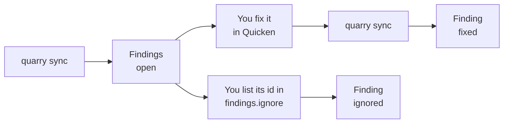

# Findings and the cleanup loop

Every Quicken file collects small errors: a download entered twice, a transfer recorded as a withdrawal and an unrelated deposit, a merchant under five spellings, splits with no category. Each one bends a total. quarry reports them as **findings**, a worklist of changes to make in Quicken.

## quarry reports; you fix in Quicken

quarry never writes to the Quicken file, and it does not correct the data in its own store either. A correction made only in quarry would be a second version of the truth that Quicken, and everything else that reads Quicken, never sees. So the fix goes where the data lives:

Each pass through the loop leaves Quicken itself cleaner, along with every later snapshot.

Findings never fail a sync. They are separate from the checks that do: reconciled balances, split sums and share counts must match Quicken, or the sync stops and the previous store stays.

## A finding keeps its identity

quarry gives every account, transaction, payee and category an id derived from Quicken's own record, such as `txn-4410`. A re-import produces the same ids. A finding's id is built from the records it names, such as `duplicate:txn-4410+txn-4412`, so quarry can tell, on the next sync, that this is the same duplicate it reported last time, or that it has gone.

That identity is what makes the list a worklist:

| Status | Meaning |
|---|---|
| Open | The latest sync found it. |
| Fixed | An earlier sync found it and a later one no longer does. |
| Ignored | You listed its id under `findings.ignore` in the config file. Remove the id and it is listed again. |

Ignoring is the only decision quarry keeps, and it keeps it in a file you write and quarry only reads. Rebuilding the store loses nothing.

## What quarry looks for

| Type | The problem | Why it matters |
|---|---|---|
| `duplicate` | Two transactions in one account with the same amount within 3 days, unless both are reconciled | The amount is counted twice |
| `one-sided-transfer` | A transfer with no matching transaction in the other account | Money appears or vanishes |
| `unlinked-transfer` | Opposite amounts in two accounts within 3 days, not linked as a transfer | A transfer is counted as spending and as income |
| `uncategorized` | Splits with no category, grouped by payee | Spending by category is understated |
| `mixed-categories` | A payee whose transactions go back and forth between categories | Category trends move for no real reason |
| `payee-variants` | Payee names that differ only in case, punctuation, spacing or store and reference numbers | Spending by payee is split across spellings |
| `similar-categories` | Category names that differ only in case, punctuation, spacing or a plural | One kind of spending sits in two rows |
| `unused-category` | A category no transaction uses | Clutter in Quicken's category list |
| `unclassified-account` | A brokerage or retirement account not listed as registered or non-registered | `quarry acb` cannot tell which accounts to pool |
| `shares-without-cost` | Shares added to a non-registered account with no cost basis | Their cost counts as zero, which overstates the gain |

A finding names the exact records: the date, account, payee and amount of each transaction, so it can be found in Quicken's register. Each comes with the change to make.

`duplicate` and `unlinked-transfer` are candidates, not verdicts. Two identical coffees in three days are normal, which is what ignoring is for.

## Two findings that are not fixed in Quicken

`unclassified-account` is fixed in quarry's config file, because Quicken's file does not say which accounts are registered plans. It leaves the list as soon as the account is listed, without a sync. `shares-without-cost` is fixed in Quicken by entering the cost, and leaves the list on the next sync. Neither is ever marked fixed; they are gone.

## Next

[How to clean up your Quicken data](../guides/clean-up-quicken.md) walks through the worklist. The types are also on [The CLI](../reference/cli.md#quarry-findings).
