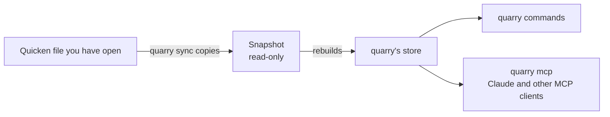

# How quarry works

quarry reads Quicken's file only to copy it, and never writes to it. Every answer comes from quarry's own store, built from that copy.

## Snapshots

`quarry sync` copies the open Quicken file into a snapshot in `~/Library/Application Support/quarry/snapshots`, rebuilds the store from it, and checks the store against Quicken's balances. After each successful sync quarry deletes the oldest snapshots beyond the newest 12 (`snapshots.keep` in the config file), never the one the store was built from. Snapshots of every Quicken file count toward the same limit. `quarry sync --from <ID>` rebuilds the store from an older snapshot without reading Quicken.

Only one `quarry sync` or `quarry snapshots prune` runs at a time; while one runs, another stops at once and changes nothing.

## The store

Every other command, and the MCP server, reads the store as it is at that moment. After a new sync, an MCP client sees the new data without a restart. SQL against the store runs read-only.

## Findings

Sync also records problems in the Quicken data — duplicates, one-sided or unlinked transfers, uncategorized splits, payee name variants and more — as a worklist. quarry never fixes them itself: you fix them in Quicken, run `quarry sync`, and fixed findings leave the list. The one exception is an investment account listed in neither `accounts.registered` nor `accounts.non-registered`, which is fixed in the config file.

## Currencies

Amounts are reported in `reporting.currency` (CAD unless set). Each split converts at the Bank of Canada rate for its date, or the latest earlier rate on weekends, holidays and dates after the last stored rate, and is rounded to the cent before it is added. With `--currency native`, CAD and USD are listed separately, never added together. Amounts dated before the first stored rate stay in their own currency, on rows of their own, with a warning. Adjusted cost base is always in CAD, as the CRA requires.

## What leaves your Mac

quarry's only network request is the exchange-rate fetch during `quarry sync`, which carries nothing but dates, back to the date of your earliest transaction. `quarry claude install` has Claude Code download quarry's plugin from GitHub; quarry itself sends nothing. `quarry mcp` opens no network port: the client talks to it over stdin and stdout.

The output of the commands Claude runs becomes part of your conversation with Claude. Payee names, memos, account names and category names reach the client as Quicken holds them; quarry does not rewrite or mask them.
