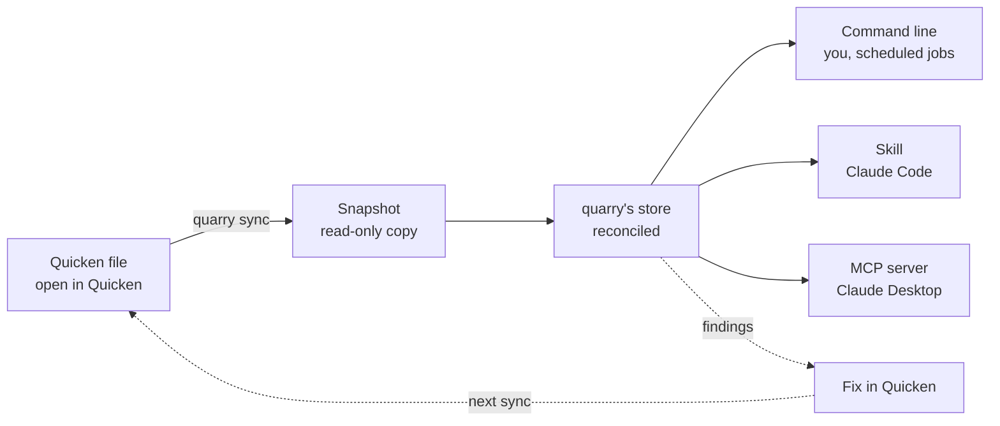

Quicken Classic for Mac, as a database you can question

# Ask your Quicken data anything. Trust the answer. {: .landing-title }

Years of categorized transactions sit in a Quicken file that only Quicken's fixed reports can read. quarry copies that file into <strong>a store of its own</strong>, <strong>checks it against Quicken's balances</strong>, and answers from it, in a terminal or through Claude, with <strong>the rules for transfers, refunds and currencies built in</strong>.

[Your first question: install to answer](tutorials/first-question.md){ .md-button .md-button--primary }
[Why quarry](concepts/why.md){ .md-button }

Open source, one binary, macOS. Your data stays on your Mac: quarry's only network request fetches exchange rates, and carries nothing but dates.

0
writes to your Quicken file, ever. quarry copies it and reads the copy

3
checks on every sync, to the cent: reconciled balances, splits, share counts

10
kinds of problems found in your data and tracked until you fix them

13
tools for Claude that return the same numbers as the command line

A wrong total looks exactly like a right one. quarry is built so that the same question gets the same answer whoever asks it. <a href="concepts/why/">The case for quarry.</a>

## What the other tools leave open {: .landing-h2 }

Two open-source projects already let an AI agent read a Quicken for Mac file: <a href="https://github.com/dweekly/quicken-mac-mcp">quicken-mac-mcp</a> and <a href="https://github.com/hardkoded/quicken-skills">quicken-skills</a>. quarry builds on what both worked out about Quicken's schema, and fills five gaps they leave.

-   :material-scale-balance: **Totals checked against Quicken**

    ---

    Both projects run SQL against Quicken's live database and report what comes back. quarry rebuilds its store on every sync and checks it against Quicken: in every reconciled account, the reconciled transactions must add up to the last reconciled statement, to the cent. A store that fails is refused, and the previous one stays.

-   :material-camera-outline: **A snapshot, not the live file**

    ---

    Both projects need Quicken open for every question, because Quicken encrypts its database when it closes. quarry needs Quicken open only for `quarry sync`. After that, every answer comes from the store, and each snapshot is kept so an answer can be reproduced.

-   :material-function-variant: **Rules in code, not in the prompt**

    ---

    What counts as spending, how a refund nets, how a transfer between your own accounts is left out: quarry's commands decide, the same way every time. The agent calls `quarry spend`; it does not rewrite the transfer rules in SQL for each question.

-   :material-clipboard-check-outline: **A worklist that closes**

    ---

    A hygiene check that counts problems starts from zero on every run. quarry gives each finding an id that stays the same from one sync to the next, so a finding is open, then fixed once you correct it in Quicken, or ignored because you said so.

-   :material-package-variant-closed: **One binary, three ways in**

    ---

    A command line for you and for scheduled jobs, a skill for Claude Code, and a local MCP server for Claude Desktop, all reading one store through one set of rules. No Node, no Python, no shell scripts.

Each gap, with what the other two do instead and where they are the better choice: <a href="concepts/why/#how-it-differs">How it differs.</a>

## One direction, from Quicken to an answer {: .landing-h2 }

Quicken stays the place you enter and fix data. quarry reads it, and tells you what to fix. <a href="concepts/how-quarry-works/">How quarry works.</a>

## What you can ask {: .landing-h2 }

In a terminal, or in plain words to Claude. Every number in the answer comes from quarry's output.

-   **Where the money went**

    ---

    "How did our grocery spending change since 2022?" Spending by category, payee, tag or month, with transfers left out and refunds netted. Income, spending and savings rate by month or year.

    `quarry spend` · `quarry cashflow`

-   **What repeats, and what stands out**

    ---

    "Which subscriptions started this year?" Charges that repeat weekly, monthly, quarterly or yearly, when each began and each price change, and charges far above what a payee usually costs.

    `quarry recurring` · `quarry anomalies`

-   **What you own**

    ---

    "What was our net worth at each month end?" Balances, holdings valued on any day, and net worth over time, in CAD, in USD, or each account in its own currency.

    `quarry networth` · `quarry holdings`

-   **Capital gains, the CRA way**

    ---

    "What gains did we realize in 2025?" Adjusted cost base per security, pooled across non-registered accounts, and realized gains per tax year, as a worksheet for your accountant.

    `quarry acb`

-   **What to clean up**

    ---

    "What is wrong with my Quicken data?" Duplicates, one-sided and unlinked transfers, uncategorized splits, payee name variants, each with the fix to make in Quicken.

    `quarry findings`

-   **Anything else**

    ---

    Find a transaction by payee, memo, amount or date, or run read-only SQL against a documented schema that does not change when Quicken's does.

    `quarry search` · `quarry sql`

## From a file only Quicken reads to answers you can check. {: .landing-h2 }

[Your first question](tutorials/first-question.md){ .md-button .md-button--primary }
[Use it with Claude](guides/use-with-claude.md){ .md-button }
[Why quarry](concepts/why.md){ .md-button }

Then <a href="concepts/">Concepts</a> for how it works, <a href="guides/">Guides</a> for one task at a time, and the <a href="reference/">Reference</a> for every command, tool and config key.

